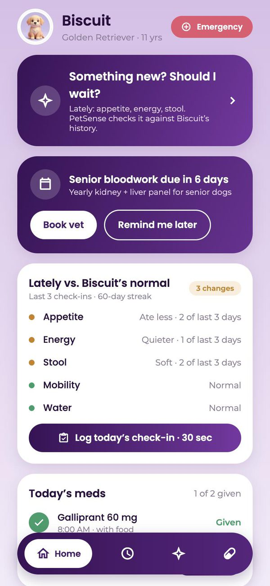
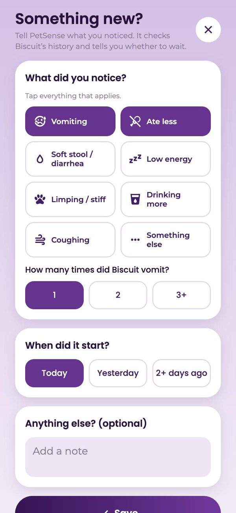
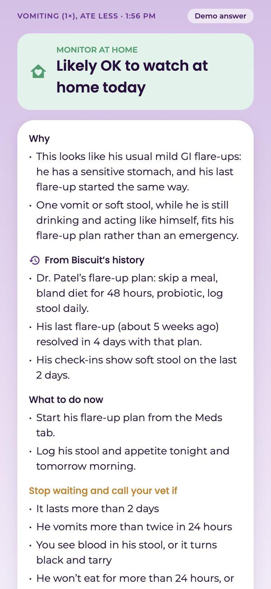
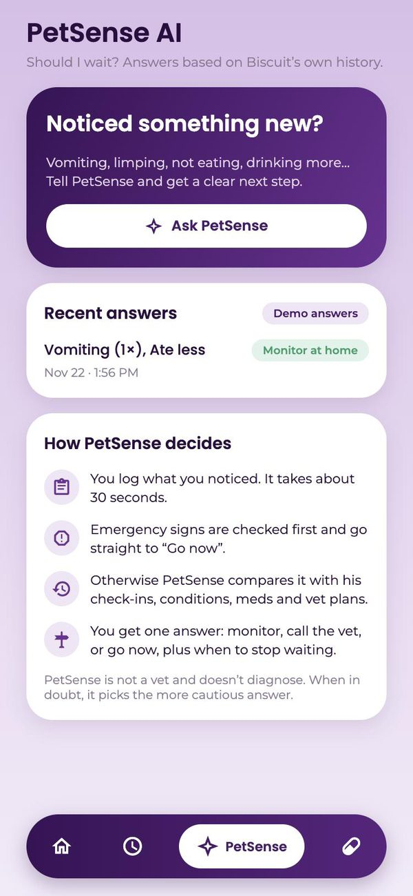
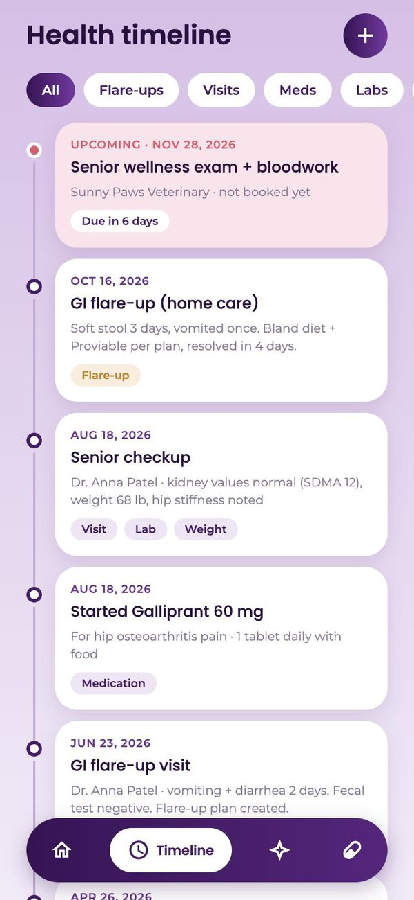
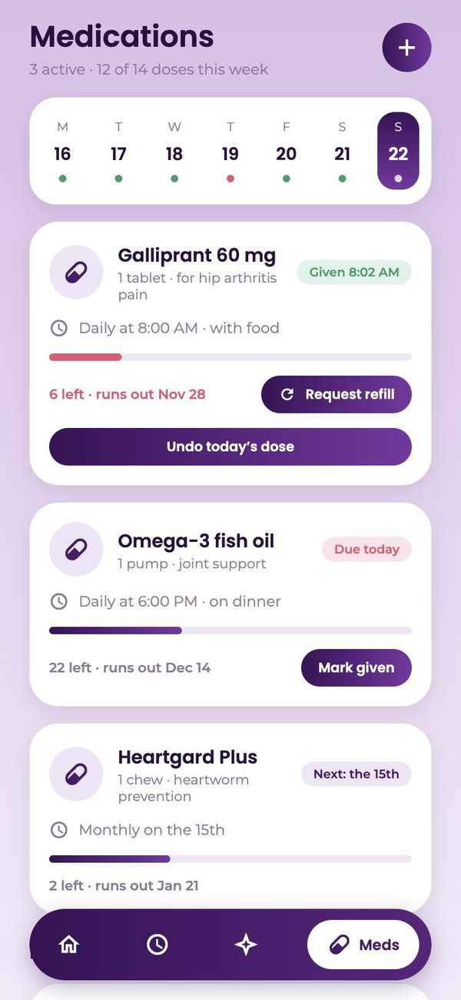
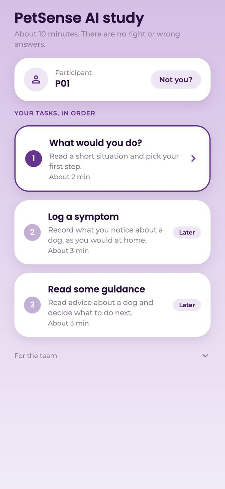

# PetSense AI

**"Should I wait?"** When a senior or chronically ill dog shows a new symptom, owners are stuck between overreacting and waiting too long. PetSense AI compares the new symptom with the dog's own health history and gives one clear next step: **monitor at home, call your vet today, or go to emergency now**, plus exactly when to stop waiting.

**Try it:** **https://petsense-ai.expo.app** works on any phone or laptop browser, with nothing to install.

Built for TECH 5900 Product Studio by Team 805.

## Screens

| Home | Should I wait? | PetSense's answer |
|:---:|:---:|:---:|
|  |  |  |
| Starts with "Something new? Should I wait?", recent changes vs. his normal, and today's meds | Log a new symptom in about 30 seconds | One level, why (from his history), and when to stop waiting |
| **PetSense tab** | **Health timeline** | **Meds** |
|  |  |  |
| Past answers and how PetSense decides | Visits, flare-ups, labs and logged symptoms | Doses, refills and the vet's flare-up plan |

Demo persona: **Biscuit**, an 11-year-old Golden Retriever with hip arthritis and a sensitive stomach, with 60 days of check-ins. Tap **Reset demo data** at the bottom of Home before a demo.

## How PetSense decides

1. **Emergency rules run first.** A swollen belly with retching, collapse, breathing trouble, poison, vomiting blood or not being able to pee goes straight to "Go to emergency now", without any AI.
2. **Otherwise it uses the dog's history.** The server sends Claude (Opus 5.5) the dog's profile, normal baseline, meds, the vet's flare-up plan, recent check-ins and timeline, and gets back a structured answer.
3. **Guardrails.** No diagnosis, no medicine or dose advice, only facts from the record, and the more cautious level when unsure.

**Demo mode:** on the public link, PetSense gives prewritten answers for free. Real AI answers only run on a device where the team passcode was entered in **Presenter mode** (bottom of Home). If the AI call fails, it falls back to the prewritten answer.

PetSense is a class prototype. It is not a vet, and its safety rules are not clinically validated.

## Experiments

Three A/B experiments with 8 dog owners each, run at `/study?code=P01` (separate from the main app). Results go straight to a Google Sheet.

| # | Question | A vs. B | Pass if |
|---|---|---|---|
| 1 | Will owners choose PetSense first? | Appetite vs. activity scenario | 5 of 8 |
| 2 | Can they log a symptom in ≤ 2 min? | Text-first vs. tap-to-pick form | 6 of 8 |
| 3 | Do they trust the advice and act safely? | Personalized vs. generic guidance | 6 of 8 |

<p align="center"><br><sub>The study page participants open</sub></p>

How to run them: [EXPERIMENT_GUIDE.md](EXPERIMENT_GUIDE.md). Demo Day checklist and script: [DEMO.md](DEMO.md). Full plan: [PLAN.md](PLAN.md).

## Tech

- **Expo SDK 58** + React Native + TypeScript, with **Expo Router** (file-based screens)
- **Zustand**: all pet data stays on the device (no database, no accounts)
- **Expo API routes** on **EAS Hosting**: `/api/petsense` (Claude via `@anthropic-ai/sdk`) and `/api/log` (to the Google Sheet). Keys stay on the server.
- Design tokens and the puppy art come from our original Figma prototype.

## Run locally

```bash
npm install
npx expo start   # press w for web, or scan the QR code with Expo Go
```

Without any settings, PetSense uses demo answers and experiment results stay queued on the device. To connect them, create a gitignored `.env.local`:

```bash
STUDY_SHEET_URL=https://script.google.com/macros/s/.../exec   # Google Sheet (setup in scripts/sheet-apps-script.gs)
ANTHROPIC_API_KEY=...                                         # real PetSense AI
PETSENSE_PASSCODE=...                                         # team passcode for Presenter mode
```

## Deploy

The live link reads the same three variables from EAS (set once; the CLI prompts for the value so secrets stay out of your shell history):

```bash
npx eas-cli@latest env:set --name ANTHROPIC_API_KEY --environment production --visibility sensitive
```

Repeat with `PETSENSE_PASSCODE` and `STUDY_SHEET_URL`. Then export and deploy. The live link can take a few minutes to switch to the new version.

```bash
npx expo export --platform web && npx eas-cli@latest deploy --prod --environment production
```

## Project structure

| Path | What |
|---|---|
| `app/(tabs)/` | Home, Timeline, PetSense and Meds tabs |
| `app/symptom.tsx`, `app/triage/[id].tsx` | "Should I wait?" form and PetSense's answer |
| `app/checkin.tsx`, `app/presenter.tsx` | Daily check-in, Presenter mode |
| `app/study/` | Experiment screens (adoption, logging, trust) |
| `app/api/` | Server routes: `petsense+api.ts`, `log+api.ts` |
| `src/petsense/` | Emergency rules, demo answers, Claude prompt, dog-history summary |
| `src/study/` | A/B assignment, result logging, offline queue, task content |
| `src/symptom/` | Reusable symptom form |
| `src/seed/`, `src/store/` | Biscuit's demo data, on-device store |
| `src/ui/` | Design tokens, shared components, tab bar |
| `scripts/sheet-apps-script.gs` | Google Sheet script (setup steps inside) |
